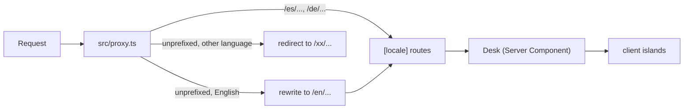

# Architecture

How a request becomes a page, and where each piece of data comes from. For rules and commands see [AGENTS.md](../AGENTS.md) and [contributing.md](contributing.md); for the security model see [security.md](security.md).

## Request flow

`src/proxy.ts` is the Next.js 16 proxy (the former middleware). It runs on every path except `_next/static`, `_next/image` and `favicon.ico`, and its own `SKIP` pattern lets `/api`, `/_next`, icons, OG images, `robots.txt`, `sitemap.xml`, the manifest, `/.well-known`, any path containing a `.`, and exactly `/donate` pass through untouched. For everything else:

| Request | Result |
| --- | --- |
| `/en` or `/en/...` | Redirect to the same path without `/en` |
| `/es`, `/de`, ... (any non-English locale prefix) | Pass through, `x-locale` request header set |
| Unprefixed path | Language picked from the `marcfors-locale` cookie if valid, else from `Accept-Language` (crawlers always get English). English is rewritten internally to `/en/...`; any other language is redirected to its prefix |

The proxy never writes the locale cookie. Only the language switcher does (`writeLocale` in `src/lib/prefs.ts`).

Locales are defined once, in `LOCALES` in `src/lib/locale.ts`: `en`, `es`, `ca`, `it`, `pt`, `de`, `fr`. English is the default and has no URL prefix.

## Page tree

`src/app/[locale]/` holds the localized routes: home (`page.tsx`, `revalidate = 3600`), `work/[slug]`, `cv`, `print`, `privacy`, `donate/thanks`, `lab/trace`, plus per-locale OG and Twitter images. `generateStaticParams` enumerates `LOCALES` (and case-study slugs, with `dynamicParams = false` for `work/[slug]`), so these are prerendered.

`src/components/Desk.tsx` is a Server Component. It renders a page from `copy[locale]` alone and never imports the whole locale map. Interactive parts are small `"use client"` islands that receive their strings as props: `SpotlightLayer`, `LanguageSwitcher`, `ThemeSwitcher`, `SignalBoard`, `TraceTheater`, `GitHubActivity`. `src/lib/__tests__/clientBundle.test.ts` fails if a client component imports `copy`. `error.tsx`, `global-error.tsx` and `not-found.tsx` are English-only for the same reason: an error boundary sits in every route's tree.

## Data and copy

| What | Where |
| --- | --- |
| UI strings, experience, career break, education, languages | `src/data/copy/<locale>.ts` (one file per locale) |
| Type every locale file must satisfy | `src/data/copy/types.ts` (`UiCopy`, `Job`) |
| Locale-independent skills and contact | `src/data/copy/shared.ts` |
| Barrel that builds the `Record<Locale, ...>` maps | `src/data/copy.ts` |
| Featured projects and lab projects | `src/data/projects.ts` (`featured`, `lab`), blurbs per locale |
| Site constants (host, email, version, dates) | `src/lib/site.ts` |

Tests keep this honest: `copy.test.ts` checks that every locale has the same keys and translated prose, and `copyUsage.test.ts` fails if a key is no longer read anywhere in `app`, `components` or `lib`.

## MDX case studies

Prose lives in `content/work/<slug>/<locale>.mdx`, one self-contained file per locale. Slugs are discovered from the directory names (`ls content/work`); at the time of writing: `wordkeep`, `habit-breaker`, `iterm-studio`, `gatto`.

- `src/data/caseStudies.ts` reads only the YAML frontmatter (`project`, `stack`, `live`, `repo`, `order`, `description`) for listings, metadata and the sitemap. It validates the shape and throws on a mismatch.
- `src/app/[locale]/work/[slug]/page.tsx` dynamically `import()`s the matching `.mdx` body.
- `@next/mdx` is configured in `next.config.ts` with `remark-frontmatter`, `remark-mdx-frontmatter` and `remark-gfm`, passed by string name because Turbopack cannot take function references. MDX compiles at build time, so the CSP needs no `unsafe-eval`.
- The privacy notice uses the same mechanism: `content/legal/privacy/<locale>.mdx`.

## Theme tokens

`THEME_PALETTES` in `src/lib/themePalettes.ts` is the only place theme colours are written (`light`, `dark`, `green`, `blue`, `red`; the user-facing choices add `system`). `scripts/gen-tokens.mjs` generates `src/app/styles/tokens.css` from it, and runs in `prebuild` and via `npm run gen:tokens`. `tokens.test.ts` fails if the committed CSS differs from what the generator would write. `ANTI_FLASH_SCRIPT` (`src/lib/theme.ts`) is an inline script in the layout that applies `data-theme` from `localStorage` before first paint. `globals.css` opens with `@layer reset, tokens, base, components`.

## GitHub activity pipeline

1. `GitHubActivity.tsx` (client) fetches `/api/github-activity` when near the viewport and again every five minutes while the tab is visible.
2. The route calls `fetchGitHubActivity()` in `src/lib/githubActivity.ts`, which makes two independent server-side requests: `https://api.github.com/users/<user>/events/public` (sends `GITHUB_TOKEN` as a bearer token if set) and `https://github.com/users/<user>/contributions` (no token; only dates, counts and intensity are parsed out of the HTML).
3. Each request has `revalidate: 300` and an 8 second timeout. A failure of one yields `null` for that half instead of invented zeros.
4. The route returns `503` if both halves are `null`, `Cache-Control: no-store` if either is, and `public, max-age=0, s-maxage=300` otherwise.

Separately, the home page calls `fetchPublicRepos()` (`src/lib/github.ts`) at render time for the public repository list.

## Support link (`/donate`)

`src/app/donate/route.ts` (outside `[locale]`, `force-dynamic`) redirects with `302` to the Payment Link in `STRIPE_SUPPORT_LINK_URL`. If `from=<slug>` is in `SUPPORT_SOURCES` (`src/lib/support.ts`) it adds `client_reference_id=<slug>`; any other value is ignored. If the variable is unset or not `https`, the route logs and returns `500`. `/donate/thanks` is a localized, `noindex` page. See [security.md](security.md) for the env var.

## Observability

| Endpoint or hook | Purpose |
| --- | --- |
| `POST /api/vitals` | Receives Core Web Vitals from `SignalBoard` (via `web-vitals`) and logs one JSON line per metric |
| `POST /api/errors` | Receives error-boundary reports from `src/lib/errors.ts` and logs one JSON line |
| `GET /api/health` | `no-store` JSON: version, release date, commit, region, header names, audit snapshot. `SignalBoard` calls it to show live status |
| `src/instrumentation.ts` | `register()` logs a `boot` line; `onRequestError` logs a `request-error` line |

Everything is `console.*` JSON on stdout/stderr; there is no log shipper or database in this repo. The site also mounts Vercel Web Analytics (`<Analytics />` in `src/app/[locale]/layout.tsx`).

## Build and prebuild

`npm run build` first runs `prebuild`:

1. `scripts/gen-tokens.mjs` regenerates `src/app/styles/tokens.css`.
2. `scripts/audit-snapshot.mjs` runs `npm audit --json --omit=dev` and writes counts to `src/generated/audit.json` (`ok` is true when there are no critical or high findings). The health endpoint and `SignalBoard` read this snapshot.

Then `next build` runs. CI (`.github/workflows/ci.yml`) adds Lighthouse budgets in a `verify` job and Playwright in an `e2e` job; `codeql.yml`, `dependabot-automerge.yml` and `production.yml` handle scanning, dependency PRs and the Vercel deploy.
